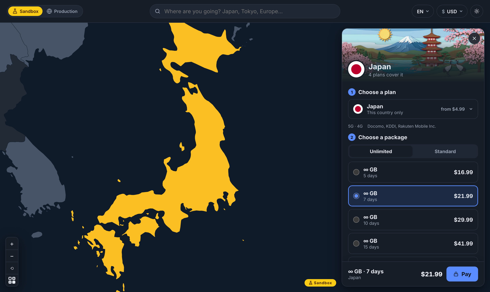
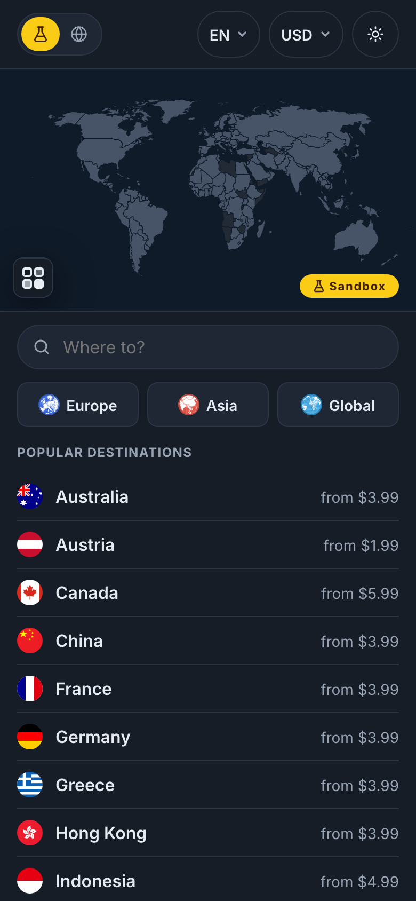
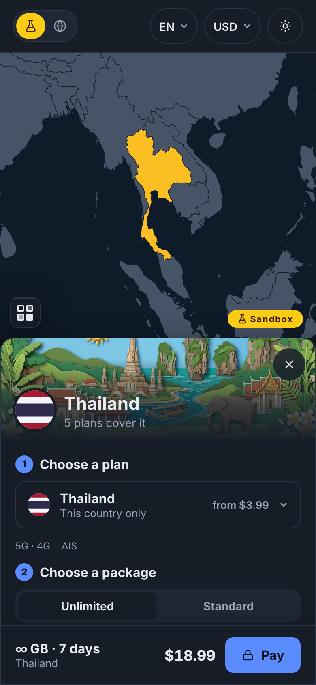

# eSIM Storefront

An open-source example of a travel eSIM store built on [Atli's eSIM API](https://github.com/Forgesoft-ai/esim-api).
Pick a destination on a world map, choose a plan, pay, and install your eSIM. It's front-end only, with no sign-in: a
guest account lives in your browser, and a private link brings it to any other.

**Try it:** [map.examples.heyatli.com](https://map.examples.heyatli.com)



> [!IMPORTANT]
> This store talks to Atli's **Sandbox** (`https://api-staging.heyatli.com`). Sandbox has its own accounts, takes test
> cards only (`4242 4242 4242 4242`, any future expiry, any CVC), and its eSIMs come from a test carrier, so they can't
> be installed on a phone. Nothing here charges real money.

## What it does

- **A world map** coloured by where Atli sells plans. Drag, zoom and click a country, or use the quick picks on a
  phone.
- **Search** for a country, region, state or city. Destinations come from heyatli.com's own list, so "Tokyo" or
  "California" finds the plans of the country they're in.
- **Plans and packages.** Every plan that covers a destination, its own first, under Atli's art and flag. A dropdown
  picks the plan, the map lights up every country it covers, and an Unlimited / Standard switch shows its packages.
  The second-cheapest unlimited package is picked to start with.
- **Checkout in a popup.** A quote with the store's partner discount, then Stripe's card form on Atli's Stripe account,
  so card details never reach the store. A 3-D Secure redirect comes back to `?order=…` and carries on.
- **The eSIM.** Once paid, the store waits for the eSIM and shows its QR code, one-tap iPhone and Android install links
  and the details to type in. A plan added to an eSIM already installed says so instead.
- **No account, a private link.** The guest is a device id kept in this browser. The private link
  (`…/#device=<id>`) restores it anywhere; the id rides in the fragment, which browsers never send to a server.
- **My eSIMs**: every eSIM on the device, its plans, data left and install details.
- **15 languages** with the same choice of default as Atli's sites (your pick, then your browser's languages, then
  English), right to left for Arabic. Names of places and plans come from the API in that language. **11 currencies**,
  and a light and dark theme.

## Screenshots

| Choosing Asia for Japan lights up every country it covers                      | Checkout: the partner discount, then Stripe's card form                      |
| ------------------------------------------------------------------------------ | ---------------------------------------------------------------------------- |
|  |  |

<p>
  
  &nbsp;
  
</p>

## Running it

```bash
npm install
npm run dev
```

Then open `http://localhost:5173`.

| Command                | What it does                     |
| ---------------------- | -------------------------------- |
| `npm run dev`          | The store, with hot reload       |
| `npm test`             | Unit tests (Vitest)              |
| `npm run lint`         | ESLint                           |
| `npm run typecheck`    | TypeScript                       |
| `npm run format:check` | Prettier                         |
| `npm run build`        | A production build, into `dist/` |

### Configuration

[`src/config.ts`](src/config.ts) holds each environment's site and **referral code**, and
[`worker/upstream.js`](worker/upstream.js) its API. Every guest the store creates is linked to that code, so their
purchases count for its partner.

| Environment         | API                               | Referral code |
| ------------------- | --------------------------------- | ------------- |
| `staging` (default) | `https://api-staging.heyatli.com` | `DMITRY-STG`  |
| `production`        | `https://api.heyatli.com`         | `ATLI-8CS9`   |

Forking it? Put your own partner code there. Sign in at [partners.heyatli.com](https://partners.heyatli.com) to get
one (it makes a partner account), and use a Sandbox account for the staging code. These variables override the file
without editing it:

| Variable                  | Read by       | What it sets                                         |
| ------------------------- | ------------- | ---------------------------------------------------- |
| `VITE_ATLI_ENV`           | the build     | `staging` or `production`: site and referral code    |
| `VITE_ATLI_REFERRAL_CODE` | the build     | The referral code new guests get                     |
| `VITE_ATLI_API_BASE`      | `npm run dev` | Another API address for the dev server to forward to |
| `ATLI_ENV`                | the proxy     | `staging` or `production`: which API it forwards to  |
| `ATLI_API_BASE`           | the proxy     | Another API address, overriding `ATLI_ENV`           |

### How the store reaches the API

The browser only ever calls the store's own address: `/api/explore/plans`, `/api/login` and so on. In development,
Vite forwards those calls to Atli's API. In production, the small proxy in [`worker/index.js`](worker/index.js) does
the same, and serves the built store from `dist/` for everything else.

- It forwards only the calls the store makes, so it isn't an open proxy to the rest of the API.
- It passes on what the API needs (the guest's token, language, the visitor's address for rate limits) and nothing
  else: no cookies, no origin.
- It's a standard Fetch-API module (`export default { fetch }`), so it runs anywhere that runs one, with the static
  files bound as `ASSETS`.

To run your own copy: `npm run build`, then serve `dist/` through the proxy.

Pull requests and pushes run [`.github/workflows/ci.yml`](.github/workflows/ci.yml): formatting, lint, types, tests
and a build.

## How it's built

| Part                                                                     | What it does                                                         |
| ------------------------------------------------------------------------ | -------------------------------------------------------------------- |
| [`src/config.ts`](src/config.ts)                                         | The environment: site and referral code                              |
| [`worker/`](worker)                                                      | The proxy: the store's `/api` forwarded to Atli's API                |
| [`src/api/atli.ts`](src/api/atli.ts)                                     | The catalogue and currencies, and the shared error shape             |
| [`src/api/account.ts`](src/api/account.ts)                               | The guest: device id, sign-in, referral, quote, purchase, eSIMs      |
| [`src/api/site.ts`](src/api/site.ts)                                     | heyatli.com's destinations: countries, regions, states and cities    |
| [`src/catalogue.ts`](src/catalogue.ts)                                   | Countries and plans from the catalogue, and the default package      |
| [`src/search.ts`](src/search.ts)                                         | How search ranks what it finds                                       |
| [`src/art.ts`](src/art.ts)                                               | Atli's flags and destination art                                     |
| [`src/map/`](src/map)                                                    | The SVG map, from [Natural Earth](https://www.naturalearthdata.com/) |
| [`src/components/CheckoutDialog.tsx`](src/components/CheckoutDialog.tsx) | Quote, Stripe, waiting for the eSIM, and installing it               |
| [`src/components/MyEsims.tsx`](src/components/MyEsims.tsx)               | The device's eSIMs                                                   |
| [`src/i18n/`](src/i18n)                                                  | The 15 languages, and how the store picks one                        |

Vite, React and TypeScript. No map service and no API key: the map is drawn from open data in the browser.

## Learn more

- [Forgesoft-ai/esim-api](https://github.com/Forgesoft-ai/esim-api): building on Atli's API, widget and payment page
- [API reference](https://partners.heyatli.com/dev/api/reference-api-heyatli-com), with a Sandbox switch
- [How to integrate the Atli eSIM API into your website or app](https://heyatli.com/blog/esim-api-integration/)

## License

[MIT](LICENSE)
