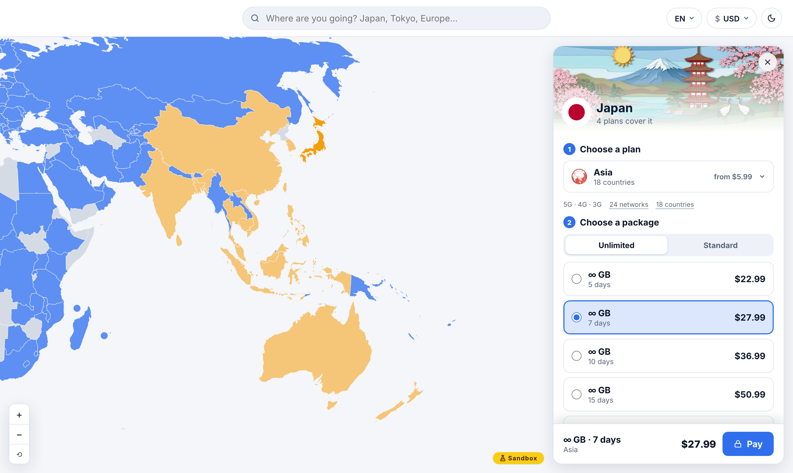
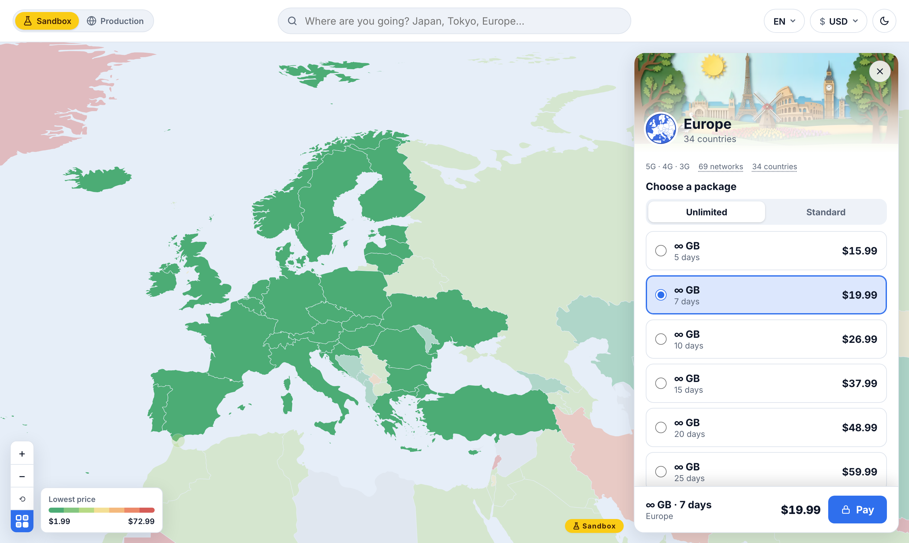
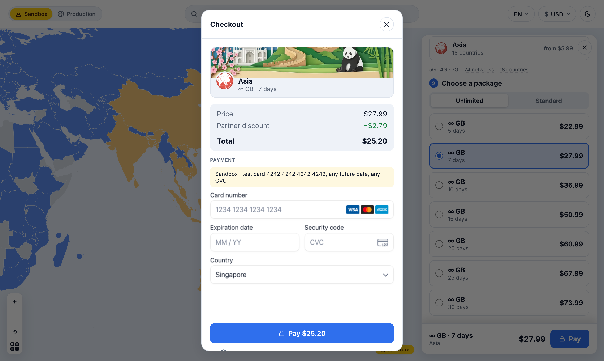

# eSIM Storefront

An open-source example of a travel eSIM store built on [Atli's eSIM API](https://github.com/Forgesoft-ai/esim-api).
Pick a destination on a world map, choose a plan, pay, and install your eSIM. It's front-end only, with no sign-in: a
guest account lives in your browser, and a private link brings it to any other.

**Try it:** [map.heyatli.com](https://map.heyatli.com)


> [!IMPORTANT]
> The switch at the top left picks Atli's **Sandbox** (the default) or **Production**. Sandbox has its own accounts,
> takes test cards only (`4242 4242 4242 4242`, any future expiry, any CVC), and its eSIMs come from a test carrier, so
> they can't be installed on a phone. **Production charges real cards and issues real eSIMs.**

## What it does

- **A world map** coloured by where Atli sells plans. Drag, zoom and click a country, or use the quick picks on a
  phone.
- **A price heatmap**, one button away on the map: every country coloured by the lowest price that covers it, green
  to red, with a key.
- **Search** for a country, region, state or city. Destinations come from heyatli.com's own list, so "Tokyo" or
  "California" finds the plans of the country they're in.
- **Plans and packages.** Every plan that covers a destination, its own first, under Atli's art and flag. A dropdown
  picks the plan, the map lights up every country it covers, and an Unlimited / Standard switch shows its packages.
  The second-cheapest unlimited package is picked to start with.
- **Checkout in a popup.** A quote with the store's partner discount, then Stripe's card form on Atli's Stripe account,
  so card details never reach the store. A 3-D Secure redirect comes back to `?order=…` and carries on.
- **The eSIM.** Once paid, the store waits for the eSIM and shows its QR code, one-tap iPhone and Android install links
  and the details to type in. A plan added to an eSIM already installed says so instead.
- **No account, a private link.** The guest is a device id kept in this browser. The private link
  (`…/#device=<id>`) restores it anywhere; the id rides in the fragment, which browsers never send to a server.
- **My eSIMs**: every eSIM on the device, its plans, data left and install details.
- **Sandbox or Production**, switched at the top left as on Atli's Partners site. Each has its own guest, eSIMs and
  private link; a private link opens in its own environment.
- **15 languages** with the same choice of default as Atli's sites (your pick, then your browser's languages, then
  English), right to left for Arabic. Names of places and plans come from the API in that language. **11 currencies**,
  and a light and dark theme.

## Screenshots

| Choosing Asia for Japan lights up every country it covers                      | The price heatmap: every country by its lowest price                                                                                                                                                                                                    |
| ------------------------------------------------------------------------------ | ------------------------------------------------------------------------------------------------------------------------------------------------------------------------------------------------------------------------------------------------------- |
|  |                                                                                                                                                                                  |
| **Checkout: the partner discount, then Stripe's card form**                    | **On a phone: quick picks, then a destination's plans**                                                                                                                                                                                                 |
|    |   |

## Running it

```bash
npm install
npm run dev
```

Then open `http://localhost:5173`.

| Command                | What it does                     |
| ---------------------- | -------------------------------- |
| `npm run dev`          | The store, with hot reload       |
| `npm test`             | Unit tests (Vitest)              |
| `npm run lint`         | ESLint                           |
| `npm run typecheck`    | TypeScript                       |
| `npm run format:check` | Prettier                         |
| `npm run build`        | A production build, into `dist/` |

### Configuration

[`src/config.ts`](src/config.ts) holds each environment's site and **referral code**, and
[`worker/upstream.js`](worker/upstream.js) its API. Every guest the store creates is linked to that code, so their
purchases count for its partner.

| Environment         | API                               | Referral code |
| ------------------- | --------------------------------- | ------------- |
| `sandbox` (default) | `https://api-staging.heyatli.com` | `DMITRY-STG`  |
| `production`        | `https://api.heyatli.com`         | `ATLI-8CS9`   |

Forking it? Put your own partner codes there. Sign in at [partners.heyatli.com](https://partners.heyatli.com) to get
one (it makes a partner account), and use a Sandbox account for the Sandbox code.

| Variable                                  | Read by                     | What it sets                                   |
| ----------------------------------------- | --------------------------- | ---------------------------------------------- |
| `VITE_ATLI_ENV`                           | the build                   | `production` to start there instead of Sandbox |
| `VITE_ATLI_API`                           | the build                   | `direct` to call Atli's API without the proxy  |
| `ATLI_SANDBOX_API`, `ATLI_PRODUCTION_API` | the proxy and `npm run dev` | Another address for either API                 |

### How the store reaches the API

The browser only ever calls the store's own address, with the environment in the path: `/api/sandbox/explore/plans`,
`/api/production/login` and so on. In development, Vite forwards those calls to that environment's API. In production, the small proxy in [`worker/index.js`](worker/index.js) does
the same, and serves the built store from `dist/` for everything else.

- It forwards only the calls the store makes, so it isn't an open proxy to the rest of the API.
- It passes on what the API needs (the guest's token, language, the visitor's address for rate limits) and nothing
  else: no cookies, no origin.
- It's a standard Fetch-API module (`export default { fetch }`), so it runs anywhere that runs one, with the static
  files bound as `ASSETS`.

To run your own copy: `npm run build`, then serve `dist/` through the proxy.

A store on an address Atli's API already accepts browser calls from, such as map.heyatli.com, can skip the proxy:
build it with `VITE_ATLI_API=direct`, and the browser calls the API itself.

Pull requests and pushes run [`.github/workflows/ci.yml`](.github/workflows/ci.yml): formatting, lint, types, tests
and a build.

### The API calls, step by step

Every call below is in [`src/api/atli.ts`](src/api/atli.ts), [`src/api/account.ts`](src/api/account.ts) or
[`src/api/site.ts`](src/api/site.ts). Paths are Atli's API's; the browser sends them as `/api/<environment>/…`, through
the proxy, except heyatli.com's destination list, which any page may read directly. Calls that act for a guest carry
`Authorization: Bearer <token>`, and calls that return names send `X-Locale`, so the names come back in the visitor's
language.

**Before anyone picks anything** (no account needed)

| Call                                   | Why                                                                                                                        |
| -------------------------------------- | -------------------------------------------------------------------------------------------------------------------------- |
| `GET /explore/plans?currency=…`        | The whole catalogue: every plan, the countries it covers, its packages and prices. It colours the map and fills the panel. |
| `GET /currencies`                      | The currencies prices can be shown and paid in, for the currency picker.                                                   |
| `GET heyatli.com/api/destinations/all` | heyatli.com's list of countries, regions, states and cities, so search finds "Tokyo" and opens Japan's plans.              |

**Paying** (when the visitor presses Pay)

| Call                                                       | Why                                                                                                                                                    |
| ---------------------------------------------------------- | ------------------------------------------------------------------------------------------------------------------------------------------------------ |
| `POST /login` `{ device_id }`                              | Signs in the guest held by this browser's device id, creating it the first time. Returns a 15-minute token; the store signs in again when it runs out. |
| `POST /user/referral/redeem` `{ code }`                    | Once per guest, before its first quote: links it to the environment's partner code, so the partner earns and its discount applies.                     |
| `POST /plan/quote` `{ product_id, currency, store: true }` | The final price, with any discount, and a `quote_id` that fixes it for 30 minutes.                                                                     |
| `GET /stripe/config`                                       | Atli's Stripe publishable key for the environment, to load Stripe's card form.                                                                         |
| `POST /plan/purchase` `{ quote_id, idempotency_key }`      | Creates the order from the quote and returns the `client_secret` Stripe's form pays. The same key never buys twice.                                    |
| _Stripe:_ `confirmPayment`                                 | Stripe.js takes the card on Atli's Stripe account; the card never reaches the store or the API. A 3-D Secure redirect comes back to `?order=…`.        |

**After paying**

| Call                                         | Why                                                                                                                            |
| -------------------------------------------- | ------------------------------------------------------------------------------------------------------------------------------ |
| `POST /plan/fulfill-payment` `{ order_id }`  | Tells Atli the payment went through, so it issues the eSIM now. Safe to repeat; if it fails, Atli still finishes a paid order. |
| `GET /fulfillment/status-updates?order_id=…` | Polled every two seconds until the order is `completed` and has the eSIM's install details: the QR code and activation code.   |

**My eSIMs**

| Call                    | Why                                                                                     |
| ----------------------- | --------------------------------------------------------------------------------------- |
| `GET /esims`            | The guest's eSIMs, each with its install details, its plans and the data used.          |
| `POST /esims/{id}/sync` | Asks the network for an eSIM's current data use, when the visitor presses Refresh data. |

Errors from all of them share one shape (`code`, `message`, `trace_id`); the store branches on `code`. The full
reference, with every field, is at [partners.heyatli.com/dev/api](https://partners.heyatli.com/dev/api/reference-api-heyatli-com).

### Building a real integration

This store is a showcase: it makes each visitor a guest from a device id kept in the browser, so it needs no sign-up
and no server. A real integration should call Atli's API with credentials of its own instead:

- **[API keys](https://partners.heyatli.com/dev/api/keys)**, for your server to call the API as your account.
- **[OAuth](https://partners.heyatli.com/dev/oauth)**, to let people sign in with their own Atli account, through a
  dedicated application that the Atli team creates for you. Write to
  [partners@heyatli.com](mailto:partners@heyatli.com).

The [API guide](https://partners.heyatli.com/dev/api), its [reference](https://partners.heyatli.com/dev/api/reference-api-heyatli-com)
and [How to integrate the Atli eSIM API](https://heyatli.com/blog/esim-api-integration/) cover both, and
[Forgesoft-ai/esim-api](https://github.com/Forgesoft-ai/esim-api) walks through building a business on them.

## How it's built

| Part                                                                     | What it does                                                         |
| ------------------------------------------------------------------------ | -------------------------------------------------------------------- |
| [`src/config.ts`](src/config.ts)                                         | The environment: site and referral code                              |
| [`worker/`](worker)                                                      | The proxy: the store's `/api` forwarded to Atli's API                |
| [`src/api/atli.ts`](src/api/atli.ts)                                     | The catalogue and currencies, and the shared error shape             |
| [`src/api/account.ts`](src/api/account.ts)                               | The guest: device id, sign-in, referral, quote, purchase, eSIMs      |
| [`src/api/site.ts`](src/api/site.ts)                                     | heyatli.com's destinations: countries, regions, states and cities    |
| [`src/catalogue.ts`](src/catalogue.ts)                                   | Countries and plans from the catalogue, and the default package      |
| [`src/search.ts`](src/search.ts)                                         | How search ranks what it finds                                       |
| [`src/art.ts`](src/art.ts)                                               | Atli's flags and destination art                                     |
| [`src/map/`](src/map)                                                    | The SVG map, from [Natural Earth](https://www.naturalearthdata.com/) |
| [`src/components/CheckoutDialog.tsx`](src/components/CheckoutDialog.tsx) | Quote, Stripe, waiting for the eSIM, and installing it               |
| [`src/components/MyEsims.tsx`](src/components/MyEsims.tsx)               | The device's eSIMs                                                   |
| [`src/i18n/`](src/i18n)                                                  | The 15 languages, and how the store picks one                        |

Vite, React and TypeScript. No map service and no API key: the map is drawn from open data in the browser.

## Learn more

- [Forgesoft-ai/esim-api](https://github.com/Forgesoft-ai/esim-api): building on Atli's API, widget and payment page
- [API reference](https://partners.heyatli.com/dev/api/reference-api-heyatli-com), with a Sandbox switch
- [How to integrate the Atli eSIM API into your website or app](https://heyatli.com/blog/esim-api-integration/)

## License

[MIT](LICENSE)
